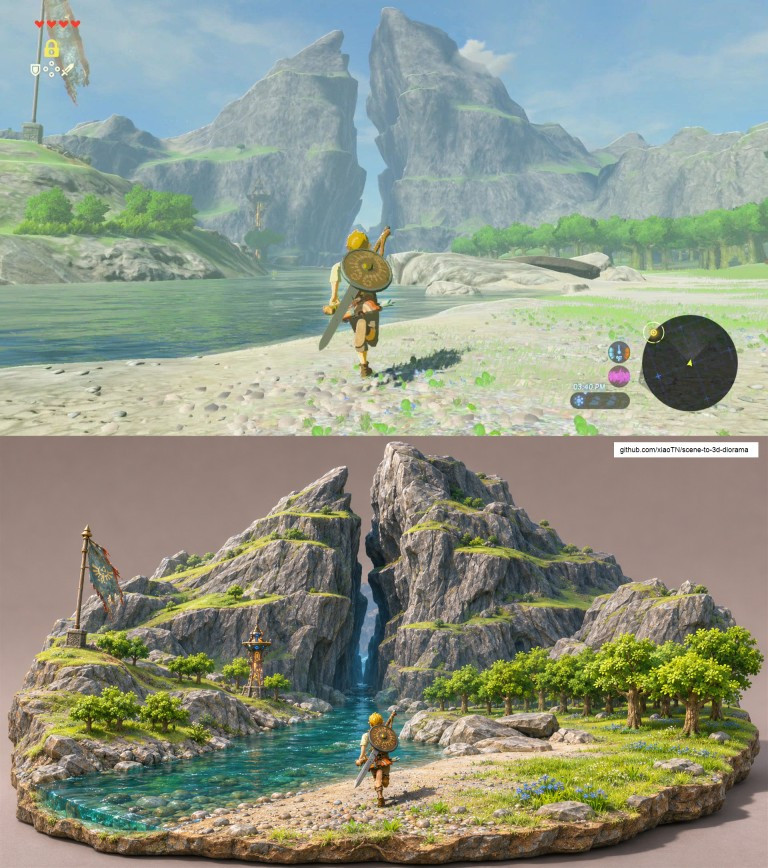
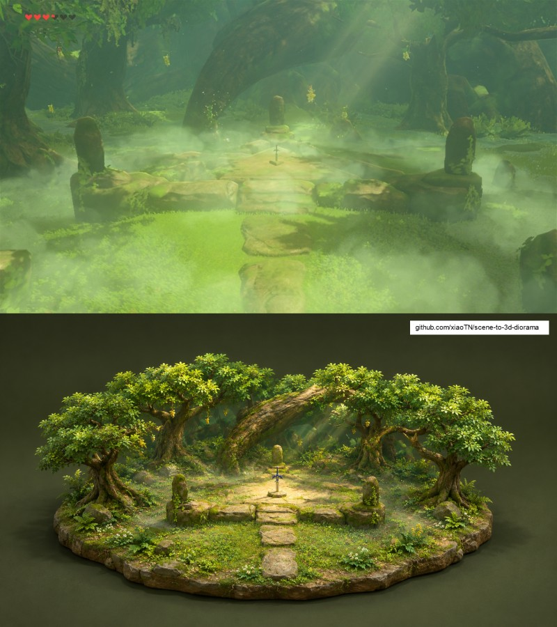
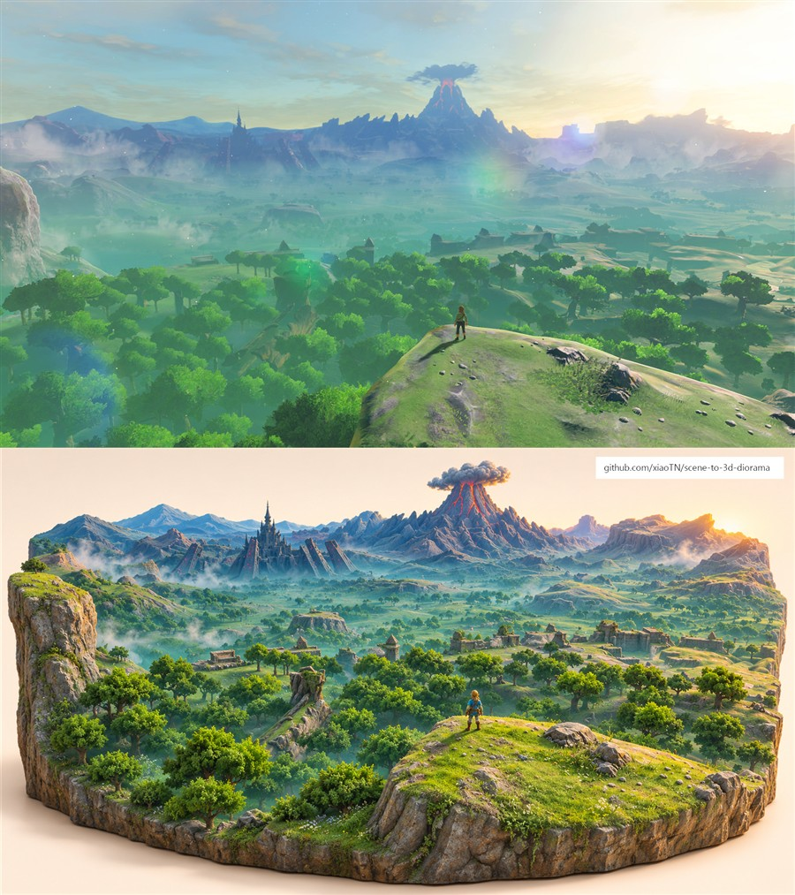

# Scene to 3D Diorama

**把风景做成桌上的微缩世界。**<br>
Turn a landscape into a standalone 3D miniature diorama image.

[效果预览](#examples) · [安装](#install) · [使用](#usage) · [English](#english) · [素材与授权](#rights)

<a id="examples"></a>
## 效果预览

《塞尔达传说：旷野之息》场景示例。**上：来源截图 · 下：AI 生成沙盘**，点击图片查看大图。<br>
*The Legend of Zelda: Breath of the Wild. Top: source screenshot. Bottom: AI-generated diorama. Click to enlarge.*

| 双子山<br>Dueling Peaks | 大师剑<br>Master Sword | 初始台地<br>Great Plateau |
| :---: | :---: | :---: |
| [](docs/examples/dueling-peaks.jpg) | [](docs/examples/master-sword.jpg) | [](docs/examples/great-plateau.jpg) |
| 山峰体积与下凹河谷 | 林间光线与独立底座 | 远近层次与地貌重构 |

默认只生成独立沙盘图；这里按要求拼接为对照图。示例用于展示效果，不代表逐像素复刻。游戏素材不属于本仓库的 MIT 授权，详见[示例来源与权利说明](docs/examples/README.md)。

### 这个 skill 做什么

- **塑造地形**：让山峰、建筑具有体积，让峡谷、河床和水潭有可见深度。
- **保留场景**：依据原图重建地貌、主体、色彩与光线。
- **设计底座**：选择适合场景的地形切片、岩石基座或浅水盆，不强制套用厚托盘。

输出是 **AI 生成的沙盘效果图**，不是可打印的 3D 模型或网格。

<a id="install"></a>
## 安装

将仓库克隆到助手的 Agent Skills 目录。以下以 `~/.agents/skills` 为例，实际路径以所用助手为准。

**macOS / Linux**

```bash
git clone https://github.com/xiaoTN/scene-to-3d-diorama.git ~/.agents/skills/scene-to-3d-diorama
```

**Windows PowerShell**

```powershell
git clone https://github.com/xiaoTN/scene-to-3d-diorama.git "$HOME\.agents\skills\scene-to-3d-diorama"
```

若助手在启动时加载技能，安装后新建或重启会话。完整指令见 [SKILL.md](SKILL.md)。

<a id="usage"></a>
## 使用

上传或指定一张图片，对支持**参考图编辑**的助手说：

> 使用 scene-to-3d-diorama，把这张风景图做成独立的 3D 微缩沙盘。山峰要突出，河谷要下凹，底座按场景设计。

可以补充材质、视角、底座形状和画面比例。需要对照时，再加一句：

> 把原图放上面，生成的沙盘放下面，拼成一张对照图。

本仓库提供技能指令，不包含生成模型或 API 密钥；需要助手具备可编辑参考图的图像生成工具。

<a id="english"></a>
## English

This Agent Skill turns a landscape photo, game screenshot, or illustration into an image of a freestanding miniature scene. It emphasizes raised terrain, recessed valleys, recognizable landmarks, and a base suited to the source.

1. **Install** into your assistant's Agent Skills directory using the [commands above](#install). Restart the session if needed.
2. **Provide a source image** to an assistant with reference-image editing.
3. **Ask:**

> Use scene-to-3d-diorama to turn this image into a standalone miniature diorama. Emphasize the raised peaks and recessed valleys; design a base that suits the scene.

By default, the output is a single diorama image. Request a top/bottom comparison separately, as in the [gallery](#examples). Results are AI-generated **images, not 3D meshes**. The repository contains instructions, not a model or API key.

<a id="rights"></a>
## 素材与授权 · Rights

请使用你有权处理的图片。公开发布或商用前，确认原素材及生成内容的使用权限、平台 AI 标识规则和品牌方要求。公开可访问的截图不等于允许再分发；[示例来源记录](docs/examples/README.md)不是授权证明。本项目与 Nintendo 无关联，亦未经其认可。

Use source material you have rights to process. Verify permissions and applicable AI-disclosure requirements before publication or commercial use. Public availability is not a redistribution license. See the [example sources and rights notes](docs/examples/README.md). This project is not affiliated with or endorsed by Nintendo.

[MIT](LICENSE) 仅适用于技能指令与文档，不授予第三方图片、游戏素材或生成结果的权利。<br>
The MIT license covers the skill instructions and documentation, not third-party images, game assets, or rights in generated outputs.
